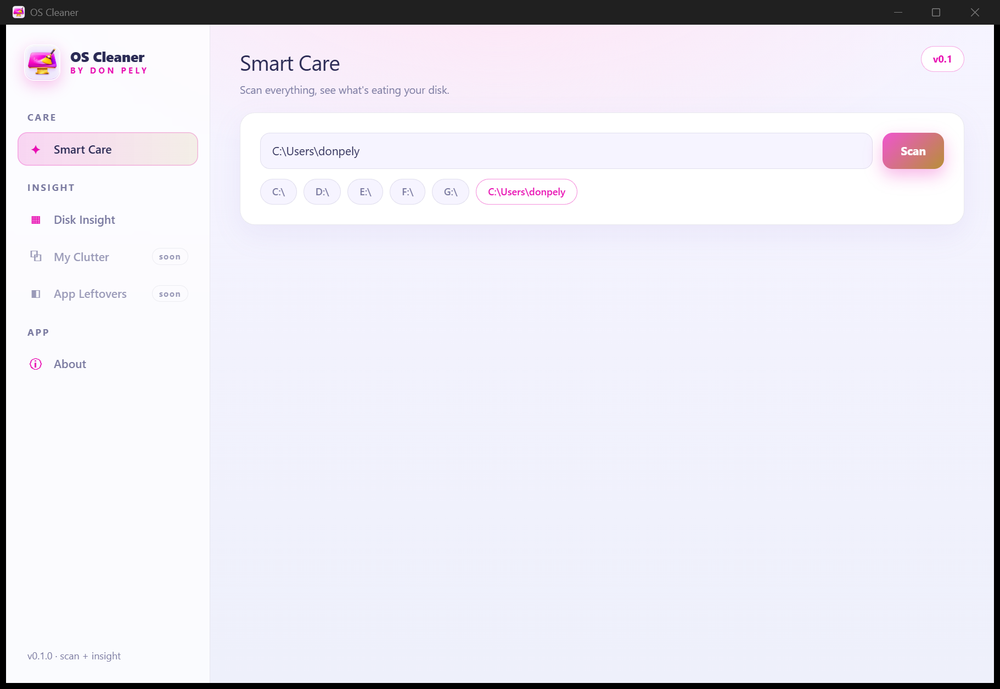

# OS Cleaner by Don Pely

> **Desktop name:** OS Cleaner. **In-app / installer name:** OS Cleaner by Don Pely.

A cross-platform, open-source (MIT) system cleaner and disk analyzer for
Windows, macOS, and Linux. Deep disk insight plus one-click care, with
a safety model proven in real cleanups (see [bloat.md](./bloat.md) for
the full session log this grew out of).

**Framework:** Tauri 2 — Rust backend + React UI.
**License:** MIT. **Releases:** GitHub releases + tags + About page.



Download installers from
[GitHub releases](https://github.com/yourbossdonpely/oscleaner/releases).

---

## 1. Vision

One beautiful app that answers "what is eating my disk?" and safely
removes what is genuinely waste — on all three desktop OSes. No scare
tactics, no deletions without evidence, every risky action backed up
first or explicitly approved.

## 2. Feature brainstorm (from real tools + our cleanup sessions)

### 2.1 Disk insight

Core file-system intelligence, built original (see §6):

- Explorer-like folder tree sorted by real size, expandable, with
  size / allocated-on-disk / file count / % of parent modes.
- Treemap: one rectangle per file, area = size, color = file type,
  click-to-zoom, at file level and folder level.
- Extension statistics: total per file type.
- Charts: bar/pie history views.
- Filters: by extension, size, age; top-N largest files list.
- Fast scanning: parallel directory walk everywhere; on Windows,
  Direct NTFS filesystem-table reads for near-instant full-drive scans.
- Correct hardlink accounting: never double-count WinSxS-style
  hardlinked bytes (the #1 lesson from our 60GB investigation).
- Reports: export scan to PDF/HTML/CSV.
- In-app actions on any node: open in file manager, delete to trash
  (never silent permanent delete), exclude from future scans.

### 2.2 One-click care

One-click maintenance, organized into focused modules:

- **Smart Care:** one button → scan everything below → single approve
  screen grouped by safety (Safe / Review / Never-touch) → run.
- **My Clutter:** large files, old files, duplicates (hash-based),
  similar photos (later, macOS/Windows).
- **App leftovers:** orphaned data from uninstalled apps (our
  ProgramData finds: Dragon Center, GFE logs, Avast Icarus…).
- **Assistant:** plain-language guidance ("your driver store has 2
  old GPU drivers, 5GB — remove?"), teach-as-it-cleans.
- **Menu-bar / tray monitor:** live disk + health + "2GB reclaimable"
  nudges from the tray.
- **Updater-style flow:** rescan → approve → run → before/after report,
  exactly like the sessions in [bloat.md](./bloat.md).

### 2.3 Real cleaner modules (proven in our sessions)

Ship these as the Windows v1 module set — each was researched against
Microsoft primary sources and executed safely:

| Module | What it does | Safety model |
|---|---|---|
| Installer orphans | Finds cached .msi/.msp with zero registry references (LocalPackage scan, HKLM+HKCU) | Move to backup folder first; delete after bake period |
| Stale drivers | Finds superseded DriverStore packages (pnputil), verifies active driver | Never touch in-use; identity re-check at runtime |
| Component store | DISM StartComponentCleanup (no ResetBase default) | Supported API only; never hand-delete WinSxS |
| AppX debloat | Per-app removal + provisioned copies, curated lists | System/framework packages blocklisted; user picks |
| Container bases | Detects orphaned Windows container/Sandbox images | Supported removal (feature/prune), never hand-delete |
| Remnant sweep | Empty dirs, dead logs, uninstalled-app leftovers | Registry cross-check before removal |
| Dev caches (later) | dotnet SDKs, npm/pip/cargo caches, Docker prune | Version-aware; keep latest N |

macOS v1 ideas: Xcode DerivedData, caches, logs, universal-binary
slimming (later), brew cleanup, login items audit.
Linux v1 ideas: journalctl vacuum, apt/dnf/pacman caches, old kernels,
flatpak/snap pruning, trash + thumbnail caches.

### 2.4 UI direction

- Sidebar module layout (6-ish modules), big friendly scan button,
  animated progress, tile/card results with plain-language labels.
- Smart Care hero is a 3D glass dial (original artwork): interactive concept + visual spec at
  [design/meter.html](./design/meter.html) — click the dial through
  idle → scanning → results → cleaning → done.
- Light + dark mode, OS-native window chrome via Tauri.
- Treemap as a hero visualization on the disk screen; the Disk view
  leads with a sortable details table (Name, Size, Allocated, Files,
  Folders, % of parent, Last Modified, Owner + toolbar: Select
  Directory, Refresh, Filter, Expand, Export) with treemap and
  bubble-map views as switchable tabs.
- Premium consumer look: light, colorful, mature — every module owns
  a color (Cleanup green, Protection pink, Performance orange,
  Applications blue, My Clutter teal, Disk Insight violet).
- Reference screens live in the repo root (`UIHOMESCREEN.png`,
  `UI.png`, `UI2.avif`, `UI3.jpg`, `cleanDONE.jpg`,
  `ref-logo-3d-desktop.png`, `LOGO3.jpg`): study direction only —
  never ship third-party pixels (see §6).
- Every destructive action: preview list → approve → undo info.
- Tech suggestion: React + TypeScript + Tailwind + a polished
  component set (shadcn-style); charts via a treemap-capable lib;
  framer-motion-class micro-animation (tasteful, friendly).

### 2.5 Brand + packaging

- Original logo + app icon: designed by Don Pely — a glossy 3D pink
  screen swept by a golden broom on a gold stand, with "Don PELY"
  embossed in gold — see [brand/preview.html](./brand/preview.html).
  `brand/` holds the untouched original plus transparent 1024 + 512
  exports; earlier concepts live in `brand/retired-c/`.
- Installers: NSIS (Windows), DMG (macOS), AppImage/DEB/RPM (Linux)
  via Tauri bundler; winget/brew wingman entries later.
- Auto-update via Tauri updater (signed updates).
- GitHub: README, LICENSE (MIT), releases, tags, About screen,
  screenshots, contributing guide.

## 3. Architecture sketch

```
React UI (scan views, treemap, approve flows)
        ⇅ Tauri IPC (scoped capabilities)
Rust core: parallel scanner ─┬─ Windows cleaners (DISM/pnputil/MSI APIs)
         treemap model ─────┼─ macOS cleaners (later)
         safety engine ─────┴─ Linux cleaners (later)
Safety engine: never-touch lists, backup-first moves,
               elevation broker (UAC/pkexec/osascript),
               dry-run diffs, per-action undo log.
```

- Elevation: privileged ops run through a broker helper per OS;
  UI always says what needs admin BEFORE asking (our UAC pattern).
- Never shell out to `rm -rf` equivalents on user data paths;
  typed Rust file ops with path validation + trash-first deletes.

## 4. Skills for the build session (from ~/.agents/skills)

Duplicate skill ids exist, so load by full path:

- **Tauri router (load first):**
  `$HOME/.agents/skills/full-stack-skills-tauri/SKILL.md`
  Routes to sub-skills: start with `tauri-app-planning`, then
  `tauri-setup`, `tauri-app-develop`, plus plugins as needed
  (fs, dialog, updater, autostart, notification, store).
  Alternates: `epicenterhq-tauri`, `lynricsy-tauri`.
- **React:** five duplicates; try first:
  `$HOME/.agents/skills/vercel-labs-react/SKILL.md`
  (alternates: blencorp, lynricsy, nimadorostkar, pedronauck).
- **Research method that worked here:**
  `$HOME/.agents/skills/research/SKILL.md`
  (primary sources only, findings to Markdown).

## 5. Roadmap

0. (done) Branding + UX concepts: owner logo with gold seal
   (`brand/`), Smart Care dial concept (`design/meter.html`),
   reference screens, disk-table study.
1. (done in v0.1.0) Scaffold Tauri 2 + React + TS + Tailwind; CI builds all OSes.
2. (started) Serial hardlink-aware scanner + sortable table; parallel + treemap next.
3. Windows Safe module set (§2.3) with backup-first + approve flow.
4. Premium visual pass + logo/icon + dark mode.
5. Beta: dogfood on real machines (this PC first), MIT release v0.1.
6. macOS modules, then Linux modules; auto-update; stores.

## 6. Legal notes (do not skip)

- Study behaviors, write original code: do NOT copy third-party code
  into this MIT app (copyleft and proprietary licenses conflict).
- Take inspiration from features/UX only; all code, text, icons,
  images in this repo are original unless noted.
- Never bundle vendor SDKs beyond their license terms.

## 7. Open questions

1. Credit spelling — resolved: "Don Pely".
2. Logo direction — resolved: owner's golden-broom mark, see [brand/](./brand/preview.html).
3. macOS signing/notarization + Windows code signing certs?
4. Target Rust/MSRV + Node versions at scaffold time.
5. Which Linux distros/formats first (Ubuntu DEB + AppImage)?

## 8. Develop

Prereqs: Rust stable (MSVC toolchain on Windows), Node 20+.

```sh
cd app
npm install
npm run tauri dev    # run the app in development
npm run tauri build  # installer bundles (NSIS/MSI, DMG, AppImage/DEB)
cargo test --manifest-path src-tauri/Cargo.toml  # Rust unit tests
```

CI (`.github/workflows/build.yml`) builds Windows, macOS, and Linux
on every push; pushing a `v*` tag attaches the bundles to a draft
GitHub release.
